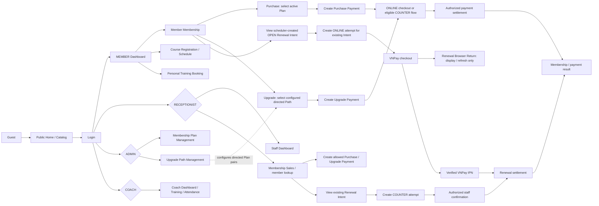

# Phase 7A — Figure 3 Screen Flow Patch

## Editable source availability

No editable Figure 3 source (`.drawio`, `.puml`, `.mmd`, `.mermaid`, `.vsdx`, `.pptx` or source SVG) was found under `docs/` or `backend/docs/`. The latest SRD is a DOCX and is not modified in this phase. Use the diagram below as the flow-content patch; apply its nodes and edges in the existing Figure 3 style rather than replacing the diagram wholesale.

## Mermaid source proposal

## Editing notes

- Keep the existing Figure 3 color palette, typography, rounded node style, arrow style and layout density. Add a Renewal sub-flow or linked inset if the main figure becomes crowded.
- Keep roles as swimlanes or visually grouped regions: Member self-service; Receptionist operations; Admin configuration; Coach workspace; public Guest.
- Draw the Upgrade Path configuration relation as a configuration dependency, not as a Member action.
- Show the Renewal Intent as created by the scheduler; Member and Receptionist act only on an existing OPEN Intent.
- Show browser Return as a display/refresh branch, separate from Renewal settlement. Verified IPN and authorized COUNTER confirmation are the Renewal collection/settlement inputs.
- Do not imply auto-charge, user-created Intent, or browser-return settlement.

## Route evidence

- Member Membership: `frontend/src/App.jsx` route `/member/membership` (around lines 713–719).
- Receptionist Membership Sales: `/receptionist/membership-sales` (around lines 560–567).
- Admin Plan/Upgrade Path management: `/staff/membership-plans` and `MembershipUpgradePathController` at `/api/membership-upgrade-paths`.
- Role-specific route groups: `MemberRoute`, `ReceptionistRoute`, `AdminRoute`, and `CoachRoute` in `frontend/src/App.jsx`.
- Member Renewal API: `/api/memberships/renewal-intents` in `MemberRenewalController`.
- Receptionist Renewal API: `/api/receptionist/members/{memberId}/renewal-intents` in `ReceptionistRenewalController`.
- VNPay Return/IPN: separate handlers in `PaymentController`.

Route presence is static source evidence, not a browser-rendering or live authorization result.
